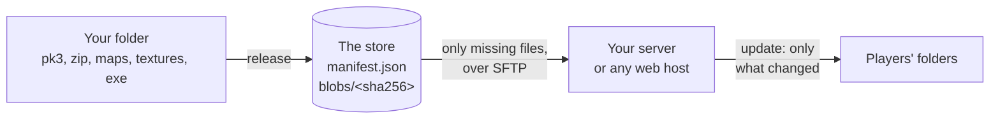

<p align="center">
  
</p>

<h1 align="center">Delta Patcher</h1>

<p align="center">
  <b>Delta patching for any game and any file.</b><br>
  Publish a folder, host it anywhere, and players download only what changed.
</p>

<p align="center">
  <a href="https://github.com/2cwldys/deltapatcher/actions/workflows/build.yml"></a>
  <a href="https://github.com/2cwldys/deltapatcher/actions/workflows/codeql.yml"></a>
  <a href="https://github.com/2cwldys/deltapatcher/actions/workflows/secret-scan.yml"></a>
</p>

<p align="center">
  <a href="https://github.com/2cwldys/deltapatcher/releases/latest"></a>&nbsp;
  <a href="https://github.com/2cwldys/deltapatcher/wiki"></a>&nbsp;
  <a href="https://github.com/2cwldys/deltapatcher/wiki/Quick-start"></a>
</p>

<p align="center">
  <a href="https://github.com/2cwldys/deltapatcher/raw/main/docs/images/app-update.png"></a>
</p>

DeltaPatcher never looks inside a file. A `.pk3`, a `.zip`, a map, a texture pack or an executable is
just bytes with a SHA-256 hash: a changed file is fetched again, an unchanged one never is, and two
identical files are stored once.

## Features

<table>
  <tr>
    <td width="33%" valign="top"><b>Only what changed</b><br>Players download just the files their folder lacks, and a cut download resumes.</td>
    <td width="33%" valign="top"><b>Safe updates</b><br>Every file is checked before it is used. A failed update is undone, and <i>Roll back</i> undoes the last one.</td>
    <td width="33%" valign="top"><b>Signed releases</b><br>Optional Ed25519 signatures: updaters refuse any release your key did not sign.</td>
  </tr>
  <tr>
    <td valign="top"><b>One button to your server</b><br><i>Release</i> sends only the missing files over SFTP and switches the new version in last.</td>
    <td valign="top"><b>Host it anywhere</b><br>Plain static files: Caddy, nginx, Apache, XAMPP, any static host, a share, or the built-in server.</td>
    <td valign="top"><b>App and command line</b><br>A clean window, a menu of plain questions, and commands for scripts and launchers.</td>
  </tr>
  <tr>
    <td valign="top"><b>Pick, do not type</b><br>Leave folders out, or let players keep their own settings and saves, by picking them.</td>
    <td valign="top"><b>Shadow patches</b><br>Release the same version again with fixes: only the changed files travel.</td>
    <td valign="top"><b>In your containers</b><br>Docker images and Pterodactyl eggs are brought up to date at every start.</td>
  </tr>
</table>

## How it works



1. **Release** hashes every file and writes a *store*: `manifest.json` lists every file, and `blobs/` holds
   each distinct file once, named by its SHA-256.
2. It sends the store to your server, missing files first and the manifest last, so players never see
   half a release.
3. **Update** compares a player's folder with the manifest, downloads what it lacks, checks it, and swaps
   it in with a journal and a rollback copy.

## Get it

From the [latest release](https://github.com/2cwldys/deltapatcher/releases/latest):

| | The app | The command line |
| --- | --- | --- |
| **Windows** | Installer: `DeltaPatcher-<version>-setup.exe`<br>No install: `...-windows-x64.zip` | [`deltapatcher-cli-windows-x64.exe`](https://github.com/2cwldys/deltapatcher/releases/latest/download/deltapatcher-cli-windows-x64.exe) |
| **Linux**<br><sub>Ubuntu 22.04+, Debian 12+</sub> | `DeltaPatcher-<version>.AppImage`<br>or `...-linux-x64.tar.gz` | [`deltapatcher-cli-linux-x64.tar.gz`](https://github.com/2cwldys/deltapatcher/releases/latest/download/deltapatcher-cli-linux-x64.tar.gz) |
| **macOS**<br><sub>Apple silicon</sub> | `DeltaPatcher-<version>-arm64.dmg`<br><sub>The first time: right-click it, then Open.</sub> | [`deltapatcher-cli-macos-arm64.tar.gz`](https://github.com/2cwldys/deltapatcher/releases/latest/download/deltapatcher-cli-macos-arm64.tar.gz) |

Everything is self-contained. Double-click the command line for a menu of plain questions (`--close`
makes it close when it is done); on Linux and macOS, unpack it with `tar -xzf` first, and give the AppImage
`chmod +x` once. Both keep themselves up to date: the app shows **Update DeltaPatcher** when a new version
is out, and the command line says `deltapatcher self-update`.

## Quick start

In the app:

1. **Release**: choose a folder, pick **This computer, to test**, and click **Release**.
2. **Update**: choose another folder, enter `http://localhost:8000/`, and click **Update**. Change a file,
   release again, update again: only that file travels.

On the command line:

```
deltapatcher release ./game --version 1.0 --to local
deltapatcher update ./my-install --source http://localhost:8000/
```

## Guides

Step by step, on the [wiki](https://github.com/2cwldys/deltapatcher/wiki):

- **[Quick start](https://github.com/2cwldys/deltapatcher/wiki/Quick-start)**: try it on your own PC in five minutes.
- **[For players](https://github.com/2cwldys/deltapatcher/wiki/For-players)**: keeping a game folder up to date.
- **[Publishing a release](https://github.com/2cwldys/deltapatcher/wiki/Publishing-a-release)**: releasing, protecting player files, signing, giving players the updater.
- **[Setting up a VPS](https://github.com/2cwldys/deltapatcher/wiki/Setting-up-a-VPS)**: deploy user, SSH key, Caddy, nginx or Apache, with or without a domain name.
- **[Command line](https://github.com/2cwldys/deltapatcher/wiki/Command-line)**: every command and option, exit codes, the settings file and logs.
- **[Docker and Pterodactyl](https://github.com/2cwldys/deltapatcher/wiki/Docker-and-Pterodactyl)**: keeping the files inside your containers at a release's version.
- **[The store and manifest](https://github.com/2cwldys/deltapatcher/wiki/Store-and-manifest-format)**: the files, the path rules, signatures, the update algorithm.
- **[Troubleshooting](https://github.com/2cwldys/deltapatcher/wiki/Troubleshooting)**: every error message and what to do.
- **[Security](SECURITY.md)**: what DeltaPatcher protects, what it leaves to you, how to report a problem.

## For developers

New to the code? [CONTEXT.md](CONTEXT.md) explains how it fits together and why, and [CLAUDE.md](CLAUDE.md)
is the checklist for changing it, for people and for Claude Code alike.

<details>
<summary><b>Use it from an AI assistant (MCP)</b></summary>

`deltapatcher mcp` runs DeltaPatcher as an MCP server, so Claude Code, Claude Desktop, VS Code or any other
MCP client can check, update, publish and release projects, read the guides, and run a self-test of the
whole cycle. It never handles a passphrase or a password. How to connect one, and every tool:
[mcp/README.md](mcp/README.md).

</details>

<details>
<summary><b>Build from source</b></summary>

You need [Python](https://www.python.org) 3.11 or later (the engine itself runs on 3.8 or later),
[Node.js](https://nodejs.org) 20 or later with npm, and [Git LFS](https://git-lfs.com) (the images and
icons are stored with it). The build installs nothing system-wide: Python packages go into `.venv`, pinned
in `requirements-build.txt`, and Node packages into `app/node_modules`, pinned in `app/package-lock.json`.

```
# Windows
powershell -ExecutionPolicy Bypass -File build.ps1          # the engine, the app, the release files (-Test: run the tests first)

# Linux, macOS
./build.sh                                                  # (--test, --engine-only)
```

The results are in `dist/`: `deltapatcher-cli[.exe]` (the command line, one file), `dist/engine/` (the
same engine as a folder, which starts faster; the app carries this one) and `dist/app/` with the app for
your system. Last, the build gathers this system's release files into `dist/release/`
(`tools/release_files.py`), named for a GitHub release. Each system's build runs on that system; the
*Build* workflow does all three, and each of its artifacts is one system's `dist/release/`. `dist/` is
not tracked by git.

**Working on the app**: build the engine once (`build.ps1 -EngineOnly`), then `cd app`, `npm ci`,
`npm run dev`. Without a built engine the app runs the engine from source (`python -m deltapatcher`).

</details>

<details>
<summary><b>Release a new version of DeltaPatcher</b></summary>

1. **Set the version.** `python tools/version.py 0.3.0` writes it everywhere it is kept
   (`deltapatcher/__init__.py`, `app/package.json` and its lock file; `pyproject.toml` reads it from the
   code). `patch`, `minor` or `major` instead of a number gives the next one; `python tools/version.py`
   alone shows the version and checks that every copy agrees.
2. **Commit and push** to `main`.
3. **Wait for the *Build* run** (the repository's **Actions** tab) to pass on Windows, Linux and macOS.
4. **Download its artifacts**: on the run's **Summary** page, under **Artifacts**: `deltapatcher-Windows`,
   `deltapatcher-Linux` and `deltapatcher-macOS`, one zip each.
5. **Make the release**: **Releases** > **Draft a new release**, tag `v0.3.0` (the tag must name the same
   version, or the build stops), and attach every file from the three zips:

   | System | Files |
   | --- | --- |
   | Windows | `DeltaPatcher-0.3.0-setup.exe`, `DeltaPatcher-0.3.0-windows-x64.zip`, `deltapatcher-cli-windows-x64.exe` |
   | macOS | `DeltaPatcher-0.3.0-arm64.dmg`, `DeltaPatcher-0.3.0-arm64-mac.zip`, `deltapatcher-cli-macos-arm64.tar.gz` |
   | Linux | `DeltaPatcher-0.3.0.AppImage`, `DeltaPatcher-0.3.0-linux-x64.tar.gz`, `deltapatcher-cli-linux-x64.tar.gz` |

   The app's files carry the version in their names; the command line's do not.
6. **Everyone on an older version is offered it**: the app shows **Update DeltaPatcher**, and the command
   line says `deltapatcher self-update`. They find the files by these names, so keep them as they are.

</details>

<details>
<summary><b>The repository, dependencies and tests</b></summary>

```
deltapatcher/     the engine (Python): publish, serve, update, deploy, signing, SSH, the command line
app/              the app (Electron, React, Tailwind): the window, which runs the engine
cli/              deltapatcher.bat / deltapatcher.sh: the command line straight from the repository
packaging/        the PyInstaller spec: the engine as one self-contained file, and as a folder for the app
tests/            the engine's tests
tools/            the icon, the screenshots, the social preview, the secret scan, the release files, CI annotations, the version, the wiki, a README preview
docs/             the guides
```

| Part | At run time | To build |
| --- | --- | --- |
| Engine | Python's standard library; `cryptography` and `bcrypt` only to make keys and sign (checking signatures needs nothing), `paramiko` only to put your key on a server with its password | PyInstaller, Pillow (the icon) |
| App | Electron | electron-vite, React, Tailwind CSS, lucide-react, zustand, TypeScript, electron-builder |
| Deploys | the system's OpenSSH client (`ssh`, `sftp`, `ssh-keygen`, `ssh-add`), built into Windows 10+, Linux and macOS | |

**Tests**: `python -m unittest discover -s tests`. They publish, serve, update and roll back real folders
over HTTP, and refuse damaged blobs, missing blobs and malicious manifests. They sign and check releases,
release the same version again with changed files, deploy through a stand-in SFTP server, put a key on a
stand-in SSH server, update DeltaPatcher from a stand-in for GitHub, walk the menu, and drive the engine's
JSON mode the way the app does.

**The guides** live in `docs/` (and `docker/README.md`, `SECURITY.md`); the wiki is made from them with
`python tools/wiki.py <a clone of the wiki>`, then a commit and push there. Edit the files here, not the
wiki.

**Preview a guide** the way GitHub shows it: `npm ci` once in `tools/readme_preview`, then
`node tools/readme_preview/render.mjs [FILE.md] [--light]` writes `dist/preview/preview.html` and a
full-page `preview.png`, taken with the Edge, Chrome or Chromium already on your computer.

</details>

## Contributing

Pull requests are welcome. Every push and pull request is built and tested on Windows, Linux and macOS,
and checked by CodeQL and a secret scan. Run `python tools/secret_scan.py` before you commit: it refuses
keys, settings files and anything like them.

## Licence

MIT. See [LICENSE](LICENSE).
