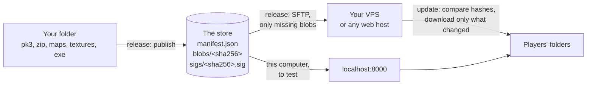

<p align="center">
  
</p>
<h1 align="center">Delta Patcher</h1>
<p align="center"><b>Delta patching with SHA-256 blobs, for any game and any file.</b><br>
Publish a folder, host it anywhere, and players download only what changed.</p>

<p align="center">
  <a href="https://github.com/2cwldys/deltapatcher/actions/workflows/build.yml"></a>
  <a href="https://github.com/2cwldys/deltapatcher/actions/workflows/codeql.yml"></a>
  <a href="https://github.com/2cwldys/deltapatcher/actions/workflows/secret-scan.yml"></a>
  <a href="LICENSE"></a>
  
</p>

<p align="center">
  
</p>

DeltaPatcher never looks inside a file. A `.pk3`, a `.zip`, a map, a texture pack or an executable is
just bytes with a SHA-256 hash: a changed file is fetched again, an unchanged one never is, and two
identical files are stored once.

<table>
  <tr>
    <td width="33%" valign="top"><b>Only what changed</b><br>Each distinct file is a blob named by its SHA-256. Updates download the blobs a folder lacks, resume cut downloads, and check every byte before anything changes.</td>
    <td width="33%" valign="top"><b>Safe updates</b><br>Every update is journalled: a failure is undone at once, a crash on the next run, and <i>Roll back</i> undoes the last one. Files players added are never touched.</td>
    <td width="33%" valign="top"><b>Signed releases</b><br>Optional Ed25519 signatures: players' updaters refuse a release that is not signed by your key, even on a compromised server.</td>
  </tr>
  <tr>
    <td valign="top"><b>Deploy over SSH</b><br>Send a release to your VPS with SFTP, uploading only missing blobs and switching the manifest in last. Host keys are confirmed once and checked strictly after.</td>
    <td valign="top"><b>Host it anywhere</b><br>The release is plain static files: Caddy, nginx, Apache or XAMPP (an <code>.htaccess</code> is written for you), any static host, a share, or the built-in server.</td>
    <td valign="top"><b>App and command line</b><br>A clean window for people and a command line for scripts and launchers. Self-contained: no Python or Node needed to run either.</td>
  </tr>
</table>

## The app

| Release | Settings |
| --- | --- |
| [](docs/images/app-release.png) | [](docs/images/app-settings.png) |
| What to release (with what to leave out and what players keep), where players download it from (your server over SSH, a folder, or this computer to test), and one **Release** button that sends only what changed. | Every setting of `deltapatcher.ini`, explained, with the log one click away. |

## How it works



1. **Release** first publishes: it hashes every file and writes a *store* (`manifest.json` with every
   path, size and SHA-256, `blobs/` with each distinct content once, and `sigs/` when you sign).
   DeltaPatcher keeps the store in its own folder; you never have to look at it.
2. Then it sends the store where players download it from: a VPS over SFTP, or a folder. Only the blobs
   the target lacks travel: first the blobs, then the signature, then the manifest, so players never see
   half a release. Releasing the same version again with changed files works the same way.
3. **Update** compares a player's folder with the manifest, downloads and checks the blobs it lacks,
   and swaps them in with a journal and a rollback copy.

## Get it

**Download** the latest build for your system from the repository's **Actions** (the *Build* workflow's
artifacts) or **Releases**:

| System | App | Command line |
| --- | --- | --- |
| Windows | `DeltaPatcher-<version>-setup.exe`, or `-windows-x64.zip` (no install: unzip, run `DeltaPatcher.exe`) | `deltapatcher-cli-windows-x64.exe` |
| Linux (Ubuntu 22.04, Debian 12 or newer) | `DeltaPatcher-<version>.AppImage` or `-linux-x64.tar.gz` | `deltapatcher-cli-linux-x64.tar.gz` |
| macOS (Apple silicon) | `DeltaPatcher-<version>-arm64.dmg` (unsigned: right-click > Open the first time) | `deltapatcher-cli-macos-arm64.tar.gz` |

Everything is self-contained: the app carries its own engine, and the command line is one program. On
Linux and macOS it comes in a `.tar.gz`: `tar -xzf <file>`, then `./deltapatcher-cli`. The AppImage needs
`chmod +x` once after downloading. Double-clicked on Windows (or `deltapatcher menu` in a terminal), the
command line opens a menu of plain questions: release a new version, set up where releases go, update a
folder. `--close` makes it close by itself when it is done (for shortcuts and launchers).

DeltaPatcher keeps itself up to date: once a day it looks for a newer release (Settings, *check_updates*,
turns that off). The app then shows **Update DeltaPatcher** in its sidebar with both version numbers; it
downloads the new setup (or AppImage, or disk image), checks it, and installs it. The command line says so
too, and `deltapatcher self-update` updates it.

## Quick start

In the app:
1. **Release**: choose the folder to release, pick **This computer, to test**, and click **Release**. The
   release is served at `http://localhost:8000/`.
2. **Update**: choose a folder to keep up to date, put in that address and click **Update**. Change a
   file, release again, and update again: only that file travels.

On the command line (`deltapatcher-cli`, or `cli\deltapatcher.bat` / `cli/deltapatcher.sh` from this repository):

```
deltapatcher release ./game --version 1.0 --to local
deltapatcher update ./my-install --source http://localhost:8000/
```

Step by step: [Quick start](docs/QUICKSTART.md).

## Documentation

| | |
| --- | --- |
| [Quick start](docs/QUICKSTART.md) | Try it on your own PC in five minutes |
| [For players](docs/PLAYERS.md) | Keeping a game folder up to date |
| [Publishing a release](docs/PUBLISHING.md) | Releasing, protecting player files, signing, giving players the updater |
| [Setting up a VPS](docs/VPS-SETUP.md) | Deploy user, SSH key, host key, Caddy, nginx, Apache, Windows Server |
| [Command line reference](docs/CLI.md) | Every command and option, exit codes, the settings file and logs |
| [Docker and Pterodactyl](docker/README.md) | Keeping the files inside your containers at a release's version |
| [The store and manifest format](docs/FORMAT.md) | The files, the path rules, signatures, the update algorithm |
| [Security](SECURITY.md) | What DeltaPatcher protects, what it leaves to you, how to report a problem |
| [Troubleshooting](docs/TROUBLESHOOTING.md) | Every error message and what to do |

## Security in short

Releases can be signed, and players' updaters then refuse anything not signed by your key. Every file
is checked against its SHA-256 before it is used, and manifests are treated as untrusted input. SSH
keys are read only by OpenSSH, and passphrases are never stored or put on a command line. Server host
keys are confirmed once and checked strictly after. The details are in **[SECURITY.md](SECURITY.md)**.

## Building from source

The repository holds two parts:

```
deltapatcher/     the engine (Python): publish, serve, update, deploy, signing, SSH, the command line
app/              the app (Electron, React, Tailwind): the window, which runs the engine
cli/              deltapatcher.bat / deltapatcher.sh: the command line straight from the repository
packaging/        the PyInstaller spec: the engine as one self-contained file, and as a folder for the app
tests/            the engine's tests
tools/            the icon, the README screenshots, the social preview, the secret scan, the release files, CI annotations, the version
docs/             the guides
```

**What you need**:
- [Python](https://www.python.org) 3.11 or later to build (the engine itself runs on Python 3.8 or later)
- [Node.js](https://nodejs.org) 20 or later, with npm
- [Git LFS](https://git-lfs.com): the images and icons are stored with it

The build installs nothing system-wide. Python packages go into `.venv`, pinned in
`requirements-build.txt`; Node packages go into `app/node_modules`, pinned in `app/package-lock.json`.

```
# Windows
powershell -ExecutionPolicy Bypass -File build.ps1          # the engine, the app, the release files (-Test: run the tests first)

# Linux, macOS
./build.sh                                                  # (--test, --engine-only)
```

The results are in `dist/`: `deltapatcher-cli[.exe]` (the command line, one file), `dist/engine/` (the
same engine as a folder, which starts faster; the app carries this one) and `dist/app/` with the app for
your system. Each system's build has to run on that system; the *Build* workflow does all three.

Last, the build gathers this system's release files into `dist/release/` (`tools/release_files.py`), named
for a GitHub release and ready to upload to one.
`dist/` is not tracked by git. Each *Build* workflow artifact is that folder for one system; macOS files
come only from there (or from a Mac).

### Releasing a new version of DeltaPatcher

1. **Set the version.** `python tools/version.py 0.3.0` writes it everywhere it is kept
   (`deltapatcher/__init__.py`, `app/package.json` and its lock file; `pyproject.toml` reads it from the
   code). `patch`, `minor` or `major` instead of a number gives the next one; `python tools/version.py`
   alone shows the version and checks that every copy agrees.
2. **Commit and push** to `main`.
3. **Wait for the *Build* run** (the repository's **Actions** tab) to pass on Windows, Linux and macOS.
4. **Download its artifacts**: on the run's **Summary** page, at the bottom under **Artifacts**:
   `deltapatcher-Windows`, `deltapatcher-Linux` and `deltapatcher-macOS`, one zip each.
5. **Make the release**: **Releases** > **Draft a new release**, tag `v0.3.0` (the tag must name the same
   version: a tag that does not stops the build), and attach the files from the three zips:

   | System | Attach | Leave out |
   | --- | --- | --- |
   | Windows | `DeltaPatcher-0.3.0-setup.exe`, `DeltaPatcher-0.3.0-windows-x64.zip`, `deltapatcher-cli-windows-x64.exe` | |
   | macOS | `DeltaPatcher-0.3.0-arm64.dmg`, `deltapatcher-cli-macos-arm64.tar.gz` | `DeltaPatcher-0.3.0-arm64-mac.zip` (the same app as the .dmg) |
   | Linux | `DeltaPatcher-0.3.0.AppImage`, `deltapatcher-cli-linux-x64.tar.gz` | `DeltaPatcher-0.3.0-linux-x64.tar.gz` (only for systems that cannot run an AppImage) |

The app's files carry the version in their names; the command line's do not.

6. **Everyone on an older version is offered it**: the app shows **Update DeltaPatcher**, and the command
   line says `deltapatcher self-update`. They find the files by these names, so keep them as they are.

**Working on the app**: build the engine once (`build.ps1 -EngineOnly`), then `cd app`, `npm ci`,
`npm run dev`. Without a built engine the app runs the engine from source (`python -m deltapatcher`).

**Dependencies**:

| Part | At run time | To build |
| --- | --- | --- |
| Engine | Python's standard library; `cryptography` and `bcrypt` only to make keys and sign (checking signatures needs nothing) | PyInstaller, Pillow (the icon) |
| App | Electron | electron-vite, React, Tailwind CSS, lucide-react, zustand, TypeScript, electron-builder |
| Deploys | the system's OpenSSH client (`ssh`, `sftp`, `ssh-keygen`, `ssh-add`), built into Windows 10+, Linux and macOS | |

**Tests**: `python -m unittest discover -s tests`. They publish, serve, update and roll back real
folders over HTTP, and refuse damaged blobs, missing blobs and malicious manifests. They sign and check
releases, deploy through a stand-in SFTP server, and drive the engine's JSON mode the way the app does.

## Contributing

Pull requests are welcome. On every push and pull request, GitHub runs:
- **Build**: on Windows, Linux and macOS, each on its own: the tests, then the engine and the app, uploaded as that system's artifact (a failing test shows as an annotation on the run)
- **CodeQL**: Python and TypeScript
- **Secret scan**: [`tools/secret_scan.py`](tools/secret_scan.py) and gitleaks

Run `python tools/secret_scan.py` before you commit: it refuses keys, settings files and anything like them.

## Licence

MIT. See [LICENSE](LICENSE).
